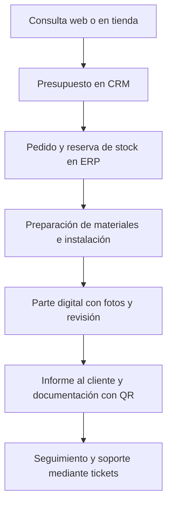

# NetInfra Solutions — Proyecto de digitalización empresarial

> **Proyecto académico de Digitalización Aplicada a los Sectores Productivos (1.º de ASIR).**  
> Empresa ficticia · Granada (España) · 12 trabajadores · Ámbito local y provincial.

## 1. ¿Qué es NetInfra Solutions?

**NetInfra Solutions** es una pequeña empresa especializada en la **venta, instalación y mantenimiento de infraestructura informática y de redes**. Trabaja principalmente con comercios, oficinas, academias y otras pymes de Granada y su provincia, aunque también atiende a particulares con necesidades técnicas específicas.

Su catálogo incluye routers, switches, puntos de acceso Wi-Fi, racks, cableado estructurado, NAS, SAI, accesorios de red, microordenadores como Raspberry Pi y material para pequeños centros de datos.

No se limita a vender productos: también estudia las necesidades del cliente, prepara presupuestos, instala equipos, certifica o comprueba conexiones y ofrece soporte posterior.

La empresa dispone de:

- **Tienda y mostrador**, con venta directa y recogida de pedidos.
- **Almacén**, con existencias y preparación de materiales.
- **Taller**, donde se configuran y prueban equipos.
- **Equipo técnico de campo**, que se desplaza a las instalaciones de los clientes.
- **Oficina**, para presupuestos, facturación, compras y atención.

### Organización y departamentos

| Área | Personal | Responsabilidades |
| --- | ---: | --- |
| Dirección | 1 | Organización, proveedores y decisiones de inversión. |
| Administración | 1 | Facturas, pagos, compras y documentación. |
| Ventas y atención al cliente | 2 | Asesoramiento, presupuestos y seguimiento comercial. |
| Tienda | 1 | Mostrador, cobros y entregas. |
| Almacén y logística | 2 | Recepción, inventario y preparación de pedidos. |
| Taller | 2 | Configuración, pruebas y reparación de equipos. |
| Instalaciones y mantenimiento | 3 | Visitas, instalaciones y asistencia técnica. |
| **Total** | **12** | |

Al ser una pyme, algunas funciones se comparten entre departamentos; por ejemplo, ventas puede actualizar el catálogo web y dirección coordinar las herramientas digitales.

## 2. Situación inicial: una empresa parcialmente digitalizada

NetInfra **no parte de cero**. Ya utiliza ordenadores, correo electrónico, hojas de cálculo, un programa de facturación sencillo y un TPV en la tienda. Sin embargo, sus herramientas no están bien conectadas entre sí.

Los problemas de partida son los siguientes:

1. **Inventario disperso:** las existencias se anotan en hojas de cálculo y no siempre coinciden con lo que se ha vendido o reservado para una instalación.
2. **Presupuestos manuales:** se elaboran en documentos y se envían por correo, sin un historial comercial centralizado.
3. **Poca presencia comercial online:** la web presenta la empresa, pero no muestra un catálogo útil con disponibilidad ni permite solicitar presupuestos de manera estructurada.
4. **Órdenes de trabajo en papel o mensajes:** los técnicos reciben instrucciones por correo o mensajería; las fotografías y anotaciones quedan repartidas.
5. **Posventa poco organizada:** las incidencias llegan por diferentes canales y cuesta conocer su estado.
6. **Escasa trazabilidad:** localizar el esquema de un rack instalado meses antes puede requerir buscar documentos o preguntar al técnico original.
7. **Poca información de las operaciones físicas:** no se registran sistemáticamente las condiciones ambientales del almacén o los consumos del banco de pruebas.

La oportunidad consiste en **integrar procesos que ya existen** para reducir tareas repetitivas, errores y tiempos de respuesta, sin convertir una empresa local en una multinacional ficticia.

## 3. Objetivos del proyecto

- Unificar ventas, compras, inventario y facturación.
- Ofrecer una web profesional con catálogo y solicitud de presupuestos.
- Mejorar la organización de instalaciones, incidencias y mantenimiento.
- Reducir documentos en papel y duplicación de datos.
- Dar a los clientes acceso seguro a la documentación de sus instalaciones.
- Aprovechar sensores e información operativa para prevenir problemas.
- Probar una aplicación de **inteligencia artificial útil y supervisada**, ajustada al tamaño de la empresa.

### Digitalización frente a transformación digital

- **Digitalizar** significa convertir una tarea o información a formato digital: un parte de trabajo electrónico en lugar de una hoja de papel.
- **Transformar digitalmente** significa cambiar cómo trabaja la empresa gracias a la conexión de sus sistemas: por ejemplo, un presupuesto aceptado reserva materiales, genera una orden de trabajo y permite emitir el informe final sin volver a introducir los mismos datos.

El proyecto contempla ambos niveles. No todas las propuestas necesitan implantarse a la vez.

## 4. Propuestas por departamento

| Área | Mejora propuesta | Beneficio esperado |
| --- | --- | --- |
| Tienda | TPV conectado al inventario y facturación; ticket impreso o enviado por correo. | Menos descuadres y mejor atención. |
| Ventas | Catálogo online, formularios de presupuesto y CRM básico. | Más oportunidades comerciales y seguimiento. |
| Almacén | Gestión de stock mediante ERP sencillo y lectura de códigos de barras o QR. | Localización más rápida y menos roturas de stock. |
| Compras y administración | Pedidos a proveedores, albaranes y facturas vinculados al sistema de gestión. | Menos transcripción manual. |
| Taller | Fichas digitales de equipos, listas de comprobación y resultados de pruebas. | Trazabilidad y calidad del trabajo. |
| Instalaciones | Aplicación móvil para partes, fotografías, materiales y firma de conformidad. | Informes consistentes y menos papel. |
| Soporte y posventa | Sistema de tickets con prioridades, estados e historial del cliente. | Menos incidencias olvidadas. |
| Dirección | Cuadro de mando con ventas, márgenes, stock e incidencias. | Decisiones basadas en datos. |

**Tecnologías previstas:** web HTML/CSS/JavaScript, ERP/TPV, CRM, base de datos, almacenamiento documental, códigos QR, dispositivos móviles, sensores IoT y, en una fase posterior, un servicio de IA para generar borradores de informes.

## 5. Tecnologías IT y OT

El enunciado del proyecto distingue **IT (Information Technology)** y **OT (Operational Technology)**.

### IT: sistemas de información

Son los sistemas que gestionan los datos del negocio: ordenadores, red corporativa, web, correo, TPV, ERP, CRM, inventario, facturación, tickets, copias de seguridad y gestión de usuarios.

### OT: supervisión de procesos físicos

NetInfra no tiene una fábrica ni una cadena de producción industrial. Su actividad permite plantear un **OT ligero y realista**:

- Sensores de **temperatura y humedad** en almacén y zona de pruebas.
- Medición del **consumo eléctrico** del banco de pruebas del taller.
- Alertas por temperatura anómala o interrupción de alimentación en equipos de pruebas, con posibilidad de automatizar ventilación o cortes seguros donde proceda.

Estos dispositivos recogen información del entorno físico de trabajo. Por otra parte, supervisar el tráfico de un router o gestionar el catálogo web sigue siendo principalmente **IT**, aunque implique hardware.

### Convergencia IT/OT

Los sensores envían datos a una plataforma que el personal autorizado puede consultar junto a los indicadores del negocio. Por ejemplo, una alerta de temperatura en el taller puede generar una revisión preventiva y quedar registrada en el sistema de incidencias.

La integración se realizaría con **segmentación de red, permisos y dispositivos actualizados**. No se expondrían sensores ni sistemas de control directamente a Internet.

## 6. Flujo integrado de extremo a extremo

Una de las mayores ventajas no está en una herramienta aislada, sino en que la información acompaña al trabajo de principio a fin.



**Caso práctico:** una academia necesita renovar su red Wi-Fi. Solicita presupuesto desde la web; ventas prepara la propuesta; tras aceptarla, almacén reserva los puntos de acceso y el cableado; el técnico consulta la orden desde el móvil, realiza la instalación y adjunta fotografías. Después se entrega un informe y se registra la documentación para futuras intervenciones. Si surge una incidencia, soporte tiene el historial sin pedir al cliente que explique todo de nuevo.

## 7. Cuatro innovaciones seleccionadas

Se proponen mejoras pequeñas pero ingeniosas, además de una incorporación de IA. Todas están pensadas para ofrecer valor sin exigir una inversión desproporcionada.

### 7.1. Ticket de compra por correo electrónico

Al cobrar en tienda, el TPV ofrece al cliente **elegir ticket impreso o envío por correo electrónico**. El envío debe ser opcional: comprar no obliga a facilitar una dirección de correo.

**Valor:** menor uso de papel, facilidad para conservar justificantes y localización de compras anteriores. El correo se utilizará para el justificante solicitado, no para publicidad sin la autorización correspondiente.

### 7.2. QR inteligente en racks e instalaciones

Después de montar un rack o una instalación, NetInfra coloca una etiqueta QR con un identificador. El cliente o un técnico autorizado puede acceder a:

- Esquema de conexiones y equipos instalados.
- Manuales, recomendaciones y documentación de entrega.
- Fechas de revisión e historial de mantenimiento.
- Canal para abrir una incidencia relacionada con esa instalación.

**Seguridad:** el QR **no contendrá contraseñas, datos personales ni documentos confidenciales**; apuntará a una página que solicitará autenticación cuando sea necesario.

### 7.3. Partes de instalación digitales y visuales

Desde el móvil, el técnico completará una plantilla sencilla con tareas realizadas, materiales utilizados, comprobaciones, fotografías del antes y después y conformidad del cliente. El sistema preparará un PDF organizado.

**Valor:** reduce pérdidas de información, mejora la calidad de entrega y facilita la facturación y el soporte posterior.

### 7.4. NetInfra AI Report: informes asistidos por IA

La novedad de inteligencia artificial consiste en **ayudar al técnico a redactar el parte final**. Tras terminar una intervención, puede grabar una nota de voz o escribir apuntes breves:

> «Instalados dos puntos de acceso en la primera planta, sustituido un switch y verificadas las conexiones. Queda pendiente cambiar una toma dañada».

El sistema transcribiría la nota, si es de voz, y generaría **un borrador estructurado** con:

1. Resumen comprensible para el cliente.
2. Detalle técnico de lo realizado.
3. Material empleado y comprobaciones efectuadas.
4. Incidencias pendientes y recomendaciones.

**El técnico debe revisar, corregir y aprobar el resultado antes de guardarlo o enviarlo.** La IA puede redactar de forma incorrecta o inventar datos; nunca se considerará una fuente de verdad independiente. Se minimizarán los datos personales enviados al servicio, se informará de su uso y se revisarán las condiciones de privacidad del proveedor.

Esta innovación es **una propuesta para una fase piloto**, no una funcionalidad que ya esté operativa en la web académica.

## 8. Plan de implantación realista

La digitalización se haría por fases para que los 12 trabajadores puedan adaptarse sin interrumpir el negocio.

| Fase | Prioridad | Actuaciones principales | Complejidad / inversión relativa |
| --- | --- | --- | --- |
| **1. Base digital** | Alta | Renovar web y catálogo, organizar documentos, implantar inventario integrado con TPV, ofrecer ticket por correo. | Media. |
| **2. Operaciones conectadas** | Alta | CRM y presupuestos, tickets de soporte, órdenes móviles, informes con fotos y QR seguros. | Media. |
| **3. Mejora avanzada** | Media | Sensores ambientales y de consumo, cuadro de mando, piloto de NetInfra AI Report. | Media-alta, según integraciones. |

Antes de contratar herramientas se compararían costes de licencias, equipos, formación, mantenimiento y soporte. La mayor inversión se justificaría solo si resuelve un problema medible. Por ejemplo, integrar inventario y ventas suele ser más prioritario que implantar IA en todas las tareas.

### Formación y adaptación

Se introducirían sesiones breves por departamento, pruebas con pocos usuarios y un periodo de convivencia entre el sistema anterior y el nuevo. Los técnicos y el personal de tienda deberían participar en el diseño de los formularios para evitar procesos incómodos.

## 9. Seguridad, privacidad y continuidad

- Cuentas individuales y permisos según el puesto; autenticación multifactor cuando esté disponible.
- Copias de seguridad periódicas y pruebas de restauración.
- Actualizaciones de equipos y software; segmentación de redes corporativas, invitados y dispositivos IoT/OT.
- Cifrado de comunicaciones y acceso autenticado a la documentación de instalaciones.
- Recogida de los datos personales mínimos necesarios, información transparente y plazos de conservación definidos.
- Revisión humana de cualquier informe generado con IA antes de incorporarlo al expediente del cliente.

La digitalización aumenta la dependencia de los sistemas informáticos: por eso también debe contemplar cómo seguir trabajando ante una avería o una caída de Internet.

## 10. Indicadores para comprobar resultados

Se mediría una situación inicial y se compararían los resultados tras la implantación. **No se presentan como cifras reales ni como ahorros garantizados.**

| Indicador | Qué permitiría comprobar |
| --- | --- |
| Tiempo medio para elaborar un presupuesto | Si el CRM y las plantillas ahorran trabajo. |
| Diferencias entre stock registrado y físico | Si la integración con el TPV reduce errores. |
| Tiempo para cerrar un parte de instalación | Si la aplicación móvil y el borrador de IA son útiles. |
| Incidencias sin seguimiento | Si el sistema de tickets mejora la posventa. |
| Consultas de documentación mediante QR | Si los clientes y técnicos reutilizan la información. |
| Consumo de papel en tickets y partes | Si los documentos digitales reducen impresiones. |

## 11. Página web del proyecto académico

Como parte de la asignatura se desarrolla una **web demostrativa de NetInfra Solutions**, con una estética tecnológica e inmersiva. Está pensada para publicarse como sitio estático mediante GitHub Pages.

**Tecnologías de la web:** HTML semántico, CSS moderno y JavaScript sin dependencias pesadas. Se priorizan las capacidades nativas del navegador para interacciones, accesibilidad y diseño adaptable; JavaScript se reserva para comportamientos que realmente lo necesitan.

Páginas previstas en el proyecto:

- `index.html`: presentación y propuesta de valor.
- `catalogo.html`: productos y categorías.
- `servicios.html`: instalación, configuración y soporte.
- `proyectos.html`: ejemplos de trabajos o casos ficticios.
- `nosotros.html`: identidad y equipo de la empresa.
- `contacto.html`: vías de contacto y solicitud de información.

### Qué demuestra la web y qué quedaría pendiente

| Alcance de la entrega | Estado |
| --- | --- |
| Diseño responsive, navegación, contenido corporativo y catálogo visual | **Prototipo web**. |
| Interacciones de interfaz, como filtros, si están implementadas en el código | **Demostración en el navegador**; no implican una base de datos real. |
| Cobros TPV, sincronización real de stock, CRM, ERP y tickets | **Propuesta de digitalización**; requiere backend, servicios e integración. |
| Envío real de correos, acceso protegido por QR y generación de informes PDF | **Propuesta**; requiere infraestructura y tratamiento seguro de datos. |
| Sensores físicos e IA para redactar informes | **Fase futura o piloto**, no servicio desplegado. |

> **Importante:** una web estática puede presentar formularios, pero no debe afirmar que ha enviado correos, cobrado pedidos o guardado datos si no existe un servicio que lo haga. Los productos, proyectos, cifras y datos de contacto mostrados en esta práctica son ficticios o ilustrativos.

### Visualización con GitHub Pages

Repositorio del proyecto: <https://github.com/alexpradoscazorla/alexpradoscazorla.github.io>

Dirección prevista de publicación: <https://alexpradoscazorla.github.io/>

Para que GitHub Pages muestre la portada, `index.html` debe estar en la **raíz de la carpeta publicada** (por ejemplo, la raíz de la rama `main` si se utiliza esa configuración), junto con los archivos CSS, JavaScript y recursos a los que hace referencia. Un `README.md` explica el proyecto en GitHub, pero **no sustituye a `index.html`** como página principal.

También puede probarse la web en local con un servidor estático, ejecutado desde la carpeta donde esté `index.html`:

```bash
python -m http.server 8000
```

Después se abre `http://localhost:8000/` en el navegador.

## 12. Conclusión

NetInfra Solutions tiene suficiente potencial para un proyecto amplio de digitalización porque combina **venta presencial, comercio online, almacén, taller, servicios técnicos, administración y atención posventa**.

El principal cambio no es comprar muchas tecnologías, sino conseguir que la información fluya entre los departamentos. El proyecto propone mejoras pequeñas y rentables —ticket electrónico, documentación QR y partes digitales—, una integración de negocio de extremo a extremo y un piloto de IA con supervisión humana. Todo ello encaja con una **pyme de tamaño medio-pequeño y ámbito provincial**, sin necesidad de inventar una fábrica o una expansión internacional.

---

**Nota:** NetInfra Solutions es una empresa ficticia creada con fines educativos. La situación inicial, los departamentos y el plan de implantación constituyen un caso de estudio propuesto, no una auditoría de una empresa real.
